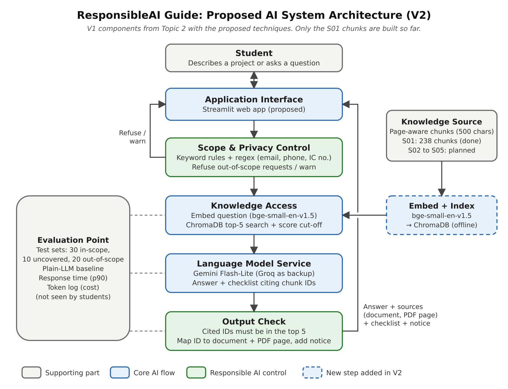
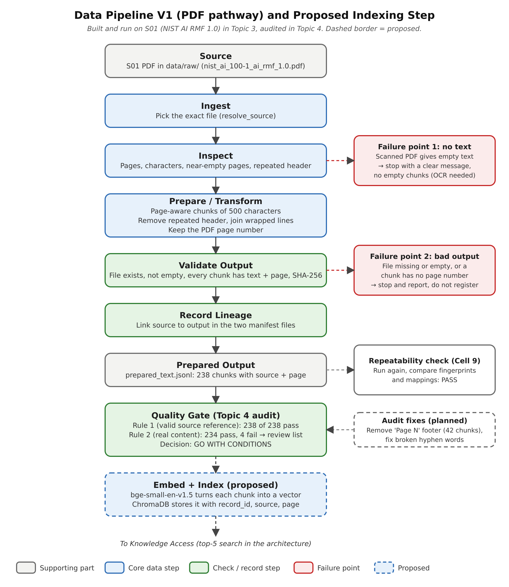

# Proposal Design: V2 Architecture and Plans (ResponsibleAI Guide)

[Back to README](../README.md) | Builds on: [Week 2 architecture decisions](week2_architecture_decisions.md), [Week 3 pipeline decisions](week3_pipeline_decisions.md), [Week 4 audit](week4_data_quality_audit.md)

This file collects the design choices for my project proposal (Topics 1 to 4). It turns the Week 2 conceptual architecture into a proposed implementation and adds the plans that were still missing.

**Nothing here is built yet, except the S01 chunks from Week 3.** I use three labels:

| Label | Meaning |
|---|---|
| **Done** | A real result already in this repo (Weeks 1 to 4) |
| **Proposed** | A design choice. Not built or measured yet |
| **Planned** | Work for a later stage |

---

## 1. From V1 to V2

The Week 2 V1 architecture names each part by what it does, not by a tool. V2 keeps the same parts and adds the proposed technique for each one. It also adds one step that V1 did not show: **Embed + Index**, which connects the Week 3 data pipeline to "Knowledge access".



| V1 component | Proposed implementation (V2) | Requirements | Status |
|---|---|---|---|
| Application interface | Streamlit web app, run locally for the demo (not deployed publicly) | FR1, FR6 | Proposed |
| Scope & privacy control | Rule-based check before the LLM: a keyword list for requests like "approve", "certify" or "is this legal", and simple patterns (regex) for emails, phone numbers and Malaysian IC numbers. It refuses or warns. The input stays only in the session and is not saved. | FR5, RAI2, RAI4 | Proposed |
| Knowledge source | Page-aware chunks of 500 characters with the PDF page number, in JSONL, with a manifest | FR2, FR3, NFR5 | **Done for S01 (238 chunks).** S02 to S05 planned |
| **Embed + Index** (new) | `bge-small-en-v1.5` turns each chunk into a list of 384 numbers (a vector). ChromaDB stores the vectors with `record_id`, `source` and `page`. | FR2, FR3, NFR5 | Proposed |
| Knowledge access | The question is turned into a vector the same way. ChromaDB returns the 5 most similar chunks. If even the best match scores below a cut-off, the answer is "not enough information". The cut-off value will be tuned on the test set, not guessed. | FR2, NFR3, RAI3 | Proposed |
| Language model service | Gemini Flash-Lite (Groq as backup). The prompt holds the 5 chunks with their IDs and the rule "answer only from these, cite the IDs". The checklist uses a fixed format: item + chunk ID. | FR1, FR4, FR6 | Proposed |
| Output check | Every cited ID must be one of the 5 retrieved. Each ID is shown as "document, PDF page N", not as the raw chunk text. Adds the "preliminary guidance only" notice. Falls back to "not enough information". | FR3, FR5, RAI1, RAI2, RAI3 | Proposed |
| Evaluation point | A Python script runs the test sets on the RAG system and on the plain-LLM baseline. It logs response time and the token counts the API returns. | NFR1 to NFR4, O3 | Proposed |

**Terms used:** an *embedding* is a list of numbers that represents the meaning of a text, so similar texts get similar numbers. A *vector store* is a database that finds the closest embeddings quickly. *Top-k* means how many chunks are returned for each question.

## 2. Technique Choices

I compared two or three realistic options for each choice. My limits are: free or low cost, works in Google Colab or on my laptop, and one semester.

| Choice | Options compared | Selected | Main reason |
|---|---|---|---|
| Embedding model | bge-small-en-v1.5, all-MiniLM-L6-v2, a paid hosted embedding API | **bge-small-en-v1.5** | Free and small enough for a CPU. It reads up to 512 tokens, so a 500-character chunk fits. MiniLM cuts text at 256 word pieces. A hosted API adds cost and sends text out again. |
| Vector store | ChromaDB, FAISS, plain NumPy search | **ChromaDB** | Stores `source` and `page` next to each vector, which helps FR3. Can delete or replace one document's chunks, which helps NFR5. |
| Top-k | 3, 5, 8 | **5** | Matches the NFR3 metric (hit rate at top 5), so the system uses exactly what I test. |
| Citation method | Ask for citations in the prompt only; attach sources after the answer; chunk-ID citations checked after the answer | **Chunk-ID citations + Output check** | It is the only option that can enforce FR3 ("SHALL NOT cite a passage that was not retrieved"). |
| Hosted LLM | Gemini Flash-Lite, Groq (open models), OpenAI gpt-4o-mini | **Gemini Flash-Lite** | Has a free tier for development and a low paid price (NFR4). The same model without retrieval is the plain-LLM baseline, so the comparison is fair (O3). |

### New decision records (same format as Week 2 D1 to D4)

| Decision | Requirement / Constraint | Alternatives considered | Selected option | Trade-off accepted |
|---|---|---|---|---|
| **D5: Local embeddings + ChromaDB** | FR2, FR3, NFR5. No budget. Colab or laptop CPU. | 1) all-MiniLM-L6-v2. 2) Hosted embedding API. 3) FAISS. 4) Plain NumPy search. | bge-small-en-v1.5 + ChromaDB | English only. A small model is weaker than large paid ones. ChromaDB installs can break between versions, so I will pin the version. |
| **D6: Retrieve the top 5 chunks** | NFR3 is measured as hit rate at top 5 | k = 3, k = 8 | k = 5 | Some of the 5 chunks may be off-topic. About 2,500 characters of context go into each prompt. |
| **D7: Chunk-ID citations checked after generation** | FR3, RAI1, RAI3, D4 | 1) Citations asked for in the prompt only. 2) Sources attached after the answer. | Chunk-ID citations + Output check | More code. It stops **made-up** citations but not **weak** ones (a real chunk that only partly supports the claim). That is why the RAI1 match rate still needs a manual check. |
| **D8: Gemini Flash-Lite as the hosted LLM** | D3, NFR4, limited budget | 1) Groq. 2) OpenAI gpt-4o-mini. | Gemini Flash-Lite, Groq as backup | On the free tier, Google says it may use the inputs to improve its products. So only made-up test descriptions go to the free tier. A version for real students would need the paid tier or a clear privacy notice (RAI4). I also depend on one provider. |

## 3. How an Answer Is Grounded

1. Scope & privacy control checks the input (refuse, warn or continue).
2. Knowledge access returns the top 5 chunks with their IDs and scores.
3. If the best score is below the cut-off, the reply is "Not enough information in the approved documents." and the LLM is not called.
4. Otherwise the LLM gets the 5 chunks and the rules in the [draft prompt](../prompts/answer_prompt_v0.md).
5. The Output check pulls every `[ID]` from the answer, rejects IDs that were not retrieved, replaces each ID with "document, PDF page N" and adds the notice.

Showing "document + page" instead of whole chunks also keeps the app from repeating large parts of the source text (see section 6).

## 4. Data Preparation Plan for S02 to S05 (Planned)

The issues below are the ones already recorded in my [Week 3 inventory](week3_data_inventory.md) and [Week 4 audit](week4_data_quality_audit.md).

| Source | Known issue | Planned preparation |
|---|---|---|
| S01 NIST AI 100-1 | "Page N" footer in 42 chunks, 4 chunks fail Rule 2, about 195 broken hyphen words (estimate) | Week 4 improvement 1: remove the footer like the header, join a broken word when the same word without the hyphen exists in the document, and join a leftover piece under 50 characters to the chunk before it. Then run Rule 1 and Rule 2 again. |
| S02 NIST AI 600-1 | 402 ligature characters (for example "ff"), blank cover page | Unicode NFKC normalisation (turns "ff" into "ff"). Skip pages with fewer than 50 characters. Keep action IDs such as MS-1.1-006 as they are. |
| S03 Malaysia AIGE | Not openly licensed. 5 near-empty pages. Sections for different audiences. | Prepare on my laptop only (see section 6). Skip near-empty pages. Add a `section` field so guidance for different audiences is not mixed. |
| S04 ASEAN Guide | Not openly licensed. 9 near-empty heading pages. Annex A is a risk assessment template (a table). | Prepare on my laptop only. Use heading pages as section labels, not as chunks. Check Annex A by eye, because `pypdf` can mix up table text. |
| S05 UNESCO (optional) | First text page is boilerplate, page number at the top, "●" bullets | Drop the boilerplate page, remove the top page numbers, replace "●" with "-". |
| All sources | The manifest says "Not verified" for version and rights. No access dates. | Fill version, access date and rights in the pipeline settings and run it again. I will not hand-edit the manifest, because that would break the lineage record. Add a `doc_id` field (S01 to S05). |

After each source is prepared, it goes through the same quality gate as S01 (Rule 1 and Rule 2), and then through Embed + Index.



## 5. Evaluation Additions

### New evaluation criteria

Two gaps were found when checking the [evaluation criteria](week2_evaluation_criteria.md): O1 had no criterion, and nothing checked the quality of the checklist (FR4), which is the main thing my project adds. Both rows are now in the criteria table.

| Objective / Requirement | Criterion | Metric | Threshold (proposed) |
|---|---|---|---|
| O1 / FR2 / NFR5 | Knowledge base coverage and quality | Required sources prepared (S01 to S04); Rule 1 and Rule 2 pass rates; manifest fields still "Not verified" | 4 of 4; 100%; 100% after human review; 0 |
| O2 / FR4 / RAI1 | Checklist relevance and linking | % of checklist items judged relevant to the project; % linked to a retrieved chunk | ≥ 80% relevant; 100% linked |

### How RAI4, NFR4 and NFR5 will be tested (planned)

| Requirement | Test |
|---|---|
| **RAI4** Privacy | Send at least 10 inputs with **made-up** emails, phone numbers and IC numbers, plus 10 clean inputs to check false alarms. Count warnings (target ≥ 90%). After the session ends, check app storage and logs for saved descriptions (target 0). |
| **NFR4** Cost | Log the token counts from the API for every call in one full evaluation run, then use the formula below. |
| **NFR5** Maintainability | Time how long it takes to add S02: run the pipeline on S02 only and add only its chunks to ChromaDB. Check that the S01 chunk count and fingerprints did not change and that S01 questions still find their chunks. Target under 15 minutes. |

### How NFR4 cost will be estimated (planned)

```
cost per query (USD)      = (input tokens × input price + output tokens × output price) ÷ 1,000,000
cost per 100 queries (RM) = 100 × cost per query (USD) × USD-to-MYR rate
```

- Input tokens = rules + student input + 5 chunks. Output tokens = answer + checklist. For models that "think", Google counts the thinking tokens as output.
- Prices and the exchange rate are taken on the day of the test and written down with the date. On 17 Nov 2026, Gemini 2.5 Flash-Lite (paid tier) was USD 0.10 per 1M input tokens and USD 0.40 per 1M output tokens, and USD 1 was about RM4.06.
- I will report the **paid-tier** cost even if testing on the free tier, because "free" does not show that the design is affordable.

**Design check (not a result):** 5 chunks of about 500 characters is about 2,500 characters, roughly 625 tokens. At the prices above, a single query would need about 60,000 output tokens to reach RM0.10 (RM10 per 100 queries). A normal answer is far below this. So the RM10 threshold is a safe upper limit, not a tight target. I will tighten it after the first measured run.

### Test set examples

Examples of each test set are in [`evaluation/test_set_examples.md`](../evaluation/test_set_examples.md). They are examples only, not the final sets.

## 6. Responsible Data Decision for S03 and S04

**What the PDFs say.** S03 (Malaysia AIGE, PDF page 2) says no part may be "reproduced, copied, stored in any retrieval system or transmitted" without prior permission. S04 (ASEAN Guide, PDF page 87) says it may not be "reproduced, republished or transmitted" without written permission. Both are free to download, but neither is openly licensed.

**Decision (17 Nov 2026).** Using these documents for a university course project is a learning use, but putting full copies in a **public** repo is republishing them. So:

- S03 and S04 are **no longer tracked in the public repo**. They are listed in [`.gitignore`](../.gitignore) and kept on my laptop and Google Drive. The links stay in [`data/data_sources.md`](../data/data_sources.md).
- Their chunks and their vector index will be made **locally only** (saved under `data/local_only/` and `chroma_db/`, both ignored by git) and not committed.
- The app will show "document + page" citations and short answers, not long copies of the source text, and it will run locally, not as a public website.
- I will confirm this with my lecturer at the proposal presentation. If she says copies are fine for course use, I can add them back.

**Known limit.** Earlier commits still contain the two PDFs in the git history. Removing them from the history would need a history rewrite. I will ask my lecturer if this is needed.

NIST (S01, S02) is free of charge, and UNESCO (S05) is Open Access (CC-BY-SA 3.0 IGO), so those three stay in the repo.

## 7. Updated Traceability Matrix

| Objective | Requirement | Evaluation criterion | Architecture element | Evidence so far / later |
|---|---|---|---|---|
| O1 | FR2 / NFR5 | Knowledge base coverage and quality | Knowledge source + data pipeline + Embed + Index | **Done for S01:** 238 chunks, Rule 1 238/238, Rule 2 234/238. Later: S02 to S04 |
| O3 | FR2 / NFR3 | Retrieval relevance | Embed + Index + Knowledge access | Hit rate at top 5 on the 30-question set |
| O2 | FR3 / RAI1 | Source citation and support | Knowledge access (IDs) + Output check | Citation presence and match results |
| O2 | FR4 / RAI1 | Checklist relevance and linking | Language model service + Output check | Results on 3 to 5 sample project descriptions |
| O2 | FR5 / RAI3 | Handling questions the documents do not cover | Knowledge access (score cut-off) + Output check | Results on the 10 uncovered questions |
| O2 | FR1 / RAI2 / RAI4 | Out-of-scope refusal and notice | Scope & privacy control + Output check | Results on 20 out-of-scope requests and the privacy test cases |
| O3 | NFR2 | Answer correctness, and improvement over a plain LLM | Evaluation point + Language model service | RAG score vs baseline score |
| O3 | NFR1 / NFR4 | Response time and cost | Whole pipeline, measured at the Evaluation point | p90 latency and token log |

## 8. Limitations and Open Issues

- Only S01 is prepared (48 of 387 pages, about 12%). All prepared data is from NIST (US), which is the representation bias found in Week 4.
- Every threshold, the cut-off score and the cost are **proposed**. No system results exist yet.
- The Week 4 pipeline fixes are not done yet.
- D7 cannot catch a real citation that only partly supports the answer. This needs a manual check.
- Permission for S03 and S04 is to be confirmed with my lecturer.

## 9. Planned Build Order

1. Clean the pipeline (Week 4 improvement 1) and run Rule 1 and Rule 2 again on S01.
2. Prepare S02, then S03 and S04 locally, then S05 if time allows.
3. Embed + Index with bge-small-en-v1.5 and ChromaDB, and test retrieval on the example questions.
4. Add the prompt, the Output check and the Scope & privacy control.
5. Write the full test sets (reference answers first), run the evaluation and compare with the plain-LLM baseline.
6. Build the Streamlit interface last.

---

**Sources for prices and the free-tier data use (checked 17 Nov 2026):** [Gemini API pricing](https://ai.google.dev/pricing). The figures were made for this file and their editable sources are the `.svg` files in [`figures/`](figures/).
